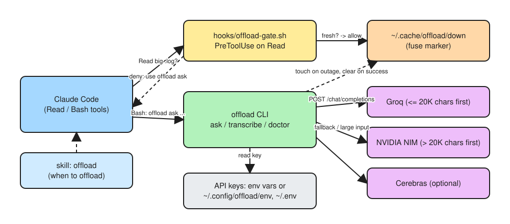
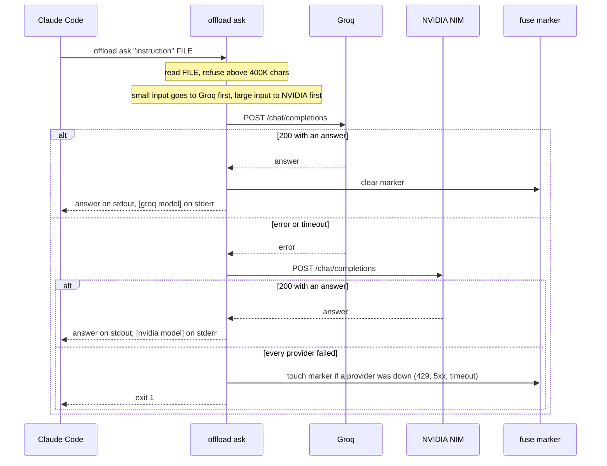
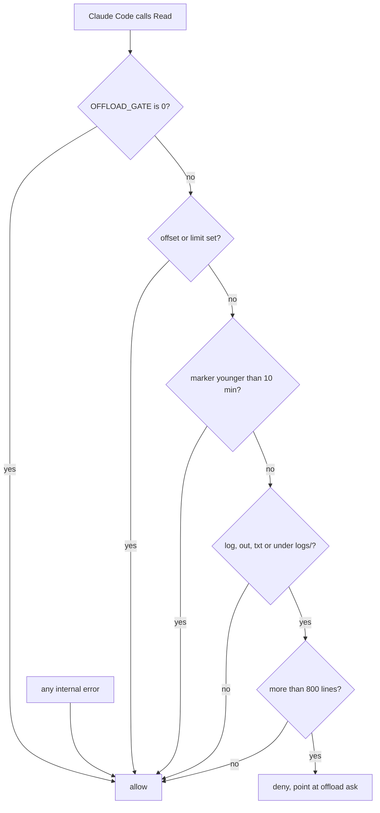

# claude-offload

Offload large-input, small-output work from Claude Code to free-tier LLM APIs.

Claude Code spends most of its quota on reading: logs, transcripts, dumps, man pages.
`offload` sends that input to a free model (Groq, NVIDIA NIM, optionally Cerebras) and
returns a short answer, so Claude's quota goes to the decisions.

One bash script, a Claude Code skill that says when to use it, and an optional hook that
keeps Claude from reading huge log files directly. Requirements: bash 3.2+, curl, jq.

## Install

1. Install the requirements: bash 3.2+, curl and jq (`brew install jq` or `apt install jq`).
2. Clone the repo and run the installer:

   ```sh
   git clone https://github.com/avkudryashov/claude-offload.git
   cd claude-offload
   ./install.sh --hook
   ```

   This links `~/.local/bin/offload`, installs the skill to `~/.claude/skills/offload/` and
   registers the Read hook. Drop `--hook` to skip the hook.
3. Make sure `~/.local/bin` is on your `PATH`.
4. Register on [Groq](https://console.groq.com/keys) and [NVIDIA](https://build.nvidia.com),
   and put the keys in `~/.config/offload/env`.
5. Run `offload doctor` to check the setup, then restart Claude Code so it picks up the skill.

To update, run `git pull` and `./install.sh --hook` again in the clone. To remove everything, run `./install.sh --uninstall`.

## How it works



### Request flow



### Hook decision



## Keys

| Provider | Key | Env var |
|---|---|---|
| NVIDIA NIM | https://build.nvidia.com, any model, *Get API Key* | `NVIDIA_API_KEY` |
| Groq | https://console.groq.com/keys | `GROQ_API_KEY` |
| Cerebras (optional) | https://cloud.cerebras.ai | `CEREBRAS_API_KEY` |

Export them, or put `NAME=value` lines in `~/.config/offload/env` (or `~/.env`). The file is
read line by line and never sourced. `offload doctor` checks what is configured.

## Usage

```sh
offload ask "In English, five bullets: what went wrong?" app.log
kubectl logs deploy/api | offload ask "List the distinct error messages as a JSON array" -
offload ask -p nvidia -m mistralai/mistral-large-4-1t-a52b "Summarize" notes.txt
offload transcribe call.m4a -- -F language=ru
offload doctor
offload providers
```

- Input comes only from the second argument: a path, or `-` for stdin. Without it the
  instruction is the whole prompt.
- The answer goes to stdout, `[provider model]` to stderr.
- Exit codes: `0` ok, `1` every provider failed, `2` usage or configuration error, `3`
  secrets found in block mode.
- Say the answer language and format in the instruction.

## Redaction

Before anything leaves the machine, `ask` masks secrets in the input and the instruction.
Each match becomes `[REDACTED:<rule>]`, and stderr gets a summary such as
`[redact] masked 2: github-pat x1, secret-assignment x1`.

- Token rules follow the [gitleaks](https://github.com/gitleaks/gitleaks) default ruleset:
  cloud, Git hosting, chat and LLM provider keys, JWTs and private keys.
- Contextual rules catch `password=`, `token:`, `Authorization: Bearer`, passwords in URLs,
  and high-entropy base64 strings, as detect-secrets does.
- Placeholders, hashes under checksum or digest keys, and configuration key names are left alone.
- If `gitleaks` is installed, its findings are masked too.

```sh
offload redact app.log                       # show what would be sent
OFFLOAD_REDACT=block offload ask "..." app.log   # refuse instead of masking, exit 3
```

Masking is best effort. Do not send `.env` files or credential dumps.

## Routing

Inputs up to 20,000 characters try Groq, then NVIDIA, then Cerebras. Larger inputs try
NVIDIA, then Cerebras, then Groq. Any error or timeout moves to the next provider. Inputs
above 400,000 characters are refused: narrow them with `grep`, `head` or `tail` first.

Default models: Groq `openai/gpt-oss-120b`, NVIDIA `nvidia/nemotron-3.5-lightning-30b-a3b`
(thinking disabled), Cerebras `gpt-oss-120b`. Override with `OFFLOAD_<ID>_MODEL`.

## Claude Code

**Skill.** Installed to `~/.claude/skills/offload/`. Tells Claude to offload summaries,
extractions, translations and transcriptions of large inputs, and not decisions or code
review.

**Hook.** `install.sh --hook` registers `hooks/offload-gate.sh` as a `PreToolUse` hook on
`Read`. It denies the read, pointing at `offload ask`, only for `.log`, `.out`, `.txt` files
or anything under `logs/`, longer than 800 lines, when the read is not ranged and the
providers were not reported down in the last 10 minutes. Source files are never blocked.
Any internal error lets the read through. `OFFLOAD_GATE=0` disables it.

## Environment

| Variable | Default | Meaning |
|---|---|---|
| `OFFLOAD_PROVIDERS` | by input size | provider order, space separated |
| `OFFLOAD_SMALL_LIMIT` | `20000` | characters that still go to Groq first |
| `OFFLOAD_MAX_CHARS` | `400000` | refuse larger inputs |
| `OFFLOAD_TIMEOUT` | `120` | seconds per request |
| `OFFLOAD_ENV_FILE` | | key file |
| `OFFLOAD_<ID>_MODEL` | | model for one provider |
| `OFFLOAD_<ID>_EXTRA` | `{}` | JSON merged into the request body |
| `OFFLOAD_REDACT` | `redact` | `redact`, `block` or `off` |
| `OFFLOAD_REDACT_PII` | `0` | `1` also masks emails and card numbers |
| `OFFLOAD_GITLEAKS` | `1` | `0` skips gitleaks even when installed |
| `OFFLOAD_GATE` | `1` | `0` disables the hook |
| `OFFLOAD_GATE_LINES` | `800` | hook line threshold |
| `OFFLOAD_GATE_EXT` | `log out txt` | hook extensions |
| `OFFLOAD_GATE_FUSE` | `600` | seconds the hook stays open after an outage |

## Testing

```sh
bats tests
```

## Licence

MIT. Token patterns are adapted from gitleaks (MIT, Copyright (c) 2019 Zachary Rice).
